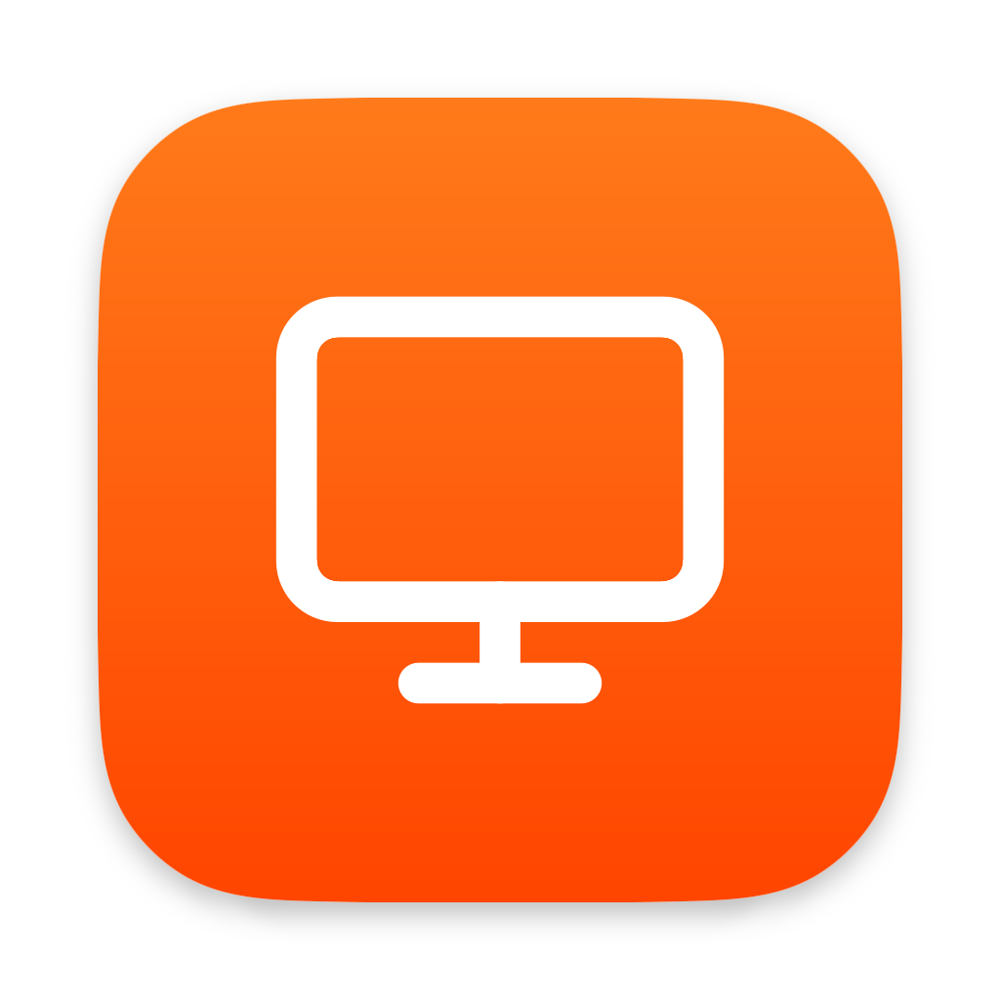
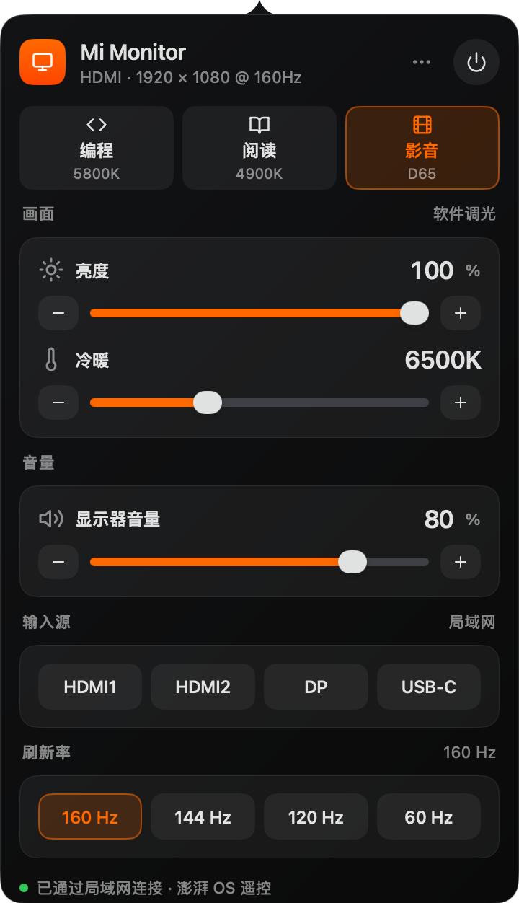

<p align="center"></p>

<h1 align="center">MonitorBar</h1>

<p align="center">macOS 菜单栏里的显示器控制：输入源、音量、亮度、色温、刷新率，一页面板。<br>
A one-panel monitor control for the Mac menu bar — <a href="#english">English</a></p>

<p align="center">

</p>

## 为什么做这个

REDMI 显示器不提供 DDC/CI，常见的显示器工具因此切不了输入源、调不了音量。它们内置的澎湃 OS 在局域网里提供了一个遥控接口，MonitorBar 就用这个接口完成输入源切换和音量调节。

支持 DDC/CI 的显示器则直接走硬件控制；只要显示器提供 Gamma 表，就能用软件调光和色温。整个应用是单个 .app：一页面板，没有标签页、webview 或单独的守护进程。

## 功能

一页，按使用频率从上到下：

- **场景**：编程 / 阅读 / 影音 三档舒适起点；前两者同时设置亮度与冷暖，影音保持亮度、只把色温归零。
- **画面**：亮度与冷暖。显示器支持 DDC/CI 时调硬件背光，否则用软件调光。
- **音量**：显示器音量；静音即把音量归零，再点恢复先前音量。
- **输入源**：HDMI / DP / USB-C 等，一键切换。右键某个接口可标记“本机连接”。
- **刷新率**：当前分辨率下的常用档位，优先保留最高档、当前档与 60 Hz。
- **显示器**：对比度、锐度、RGB 增益等 DDC/CI 画质项，显示器回应时才出现。

三条控制通道：

| 通道 | 能做什么 | 条件 |
| --- | --- | --- |
| 局域网遥控 | 切换输入源、调音量 | 澎湃 OS 显示器，与 Mac 在同一网络 |
| DDC/CI | 硬件背光、输入源、音量、画质项 | 显示器支持并在菜单中开启 |
| 显卡 Gamma 表 | 软件调光、色温 | 显示器提供 Gamma 表 |

输入源和音量优先走局域网，其次 DDC/CI；亮度有 DDC/CI 时调背光，否则用软件调光。

## 场景

三个场景是舒适起点，不是校准档。**亮度百分比以显示器自身亮度 100% 为基准**：用软件调光的显示器（如 REDMI）请把 OSD 亮度保持在 100%，把调光交给面板；支持 DDC/CI 的显示器由应用直接控制背光，无需手动设置。

| 场景 | 亮度 | 冷暖 | 白点（设计值） | 适合 |
| --- | --- | --- | --- | --- |
| 编程 Coding | 65% | 10% | ≈ 5800K | 长时间写代码：稍暖、略降亮度 |
| 阅读 Reading | 50% | 25% | ≈ 4900K | 文字阅读：更暖、更暗 |
| 影音 Movie | 保持当前 | 归零 | D65（6500K） | 影音娱乐：中性白，不动亮度 |

冷暖通过 Gamma 表的 RGB 增益实现：红通道基本不变，绿随冷暖小幅下降，蓝降幅最大。上表白点是设计目标（按 mired 换算），不是实测校准值；亮度百分比也不是 cd/m²，而是相对明暗。

## 使用

点击菜单栏图标开关面板。面板右上角：

- **⋯**：重新检测显示器、打开系统显示器设置、登录时启动、退出。
- **电源**：立即熄屏，下一次输入时唤醒。

输入源与音量：点击芯片发送切换指令；DDC/CI 能读到当前源时才会高亮。局域网接口没有当前输入源回读，应用不会伪造状态——右键某个接口标记“本机连接”，标题会显示这台 Mac 所在的接口。

## 限制

- 发布包为 Apple 芯片（arm64），要求 macOS 12+。
- 同一时间只管理一台外接显示器：优先第一台外接屏，没有外接时管理主屏。
- 局域网遥控需要显示器与 Mac 在同一网络，并允许“查找本地网络上的设备”；澎湃 OS 接口没有当前输入源回读。
- 应用已使用 Developer ID 签名，但尚未公证；首次打开仍会被 Gatekeeper 拦截，需在系统设置里点「仍要打开」。
- 软件调光走 Gamma 表，不是硬件背光；切换分辨率或唤醒后会重新应用。

## 安装

1. 到 [Releases](https://github.com/samuelhu/MonitorBar/releases) 下载最新的 macOS arm64 dmg。
2. 打开 dmg，把 **MonitorBar** 拖进「应用程序」。
3. 应用已用 Developer ID 签名，但尚未公证，首次打开仍会被 macOS 拦截：先双击一次 MonitorBar，然后打开 **系统设置 → 隐私与安全性**，滚动到底部点「**仍要打开**」并输入密码。（macOS 14 及更早版本可直接右键 → 打开。）
4. 第一次连接显示器时，允许「**查找本地网络上的设备**」——切换输入源、调音量都靠它。

可选：面板右上角「⋯」→「登录时启动」。登录项需要以 `.app` 运行；直接启动裸二进制会提示需要应用包。

## 隐私

MonitorBar 只在需要时向显示器所在的局域网发送请求（默认端口 6095），没有账号、遥测或外部服务。设置保存在 `~/Library/Application Support/MonitorBar/settings.json`。

## 构建

需要 Go 1.27+，界面基于 [mygo](https://mygo.egoist.dev/)。

```bash
go tool mygo dev                                # 开发，改动后自动重启
go tool mygo build -platform darwin/arm64       # 打包 .app 与 dmg
go test ./...                                   # 单元测试与无窗口界面测试
```

默认产物在 `build/darwin-arm64/`。如果在外置卷上构建，mygo 的 DMG 步骤可能因 `hdiutil` 挂载权限失败；用 `-o` 指向本地目录再打包即可：

```bash
go tool mygo build -platform darwin/arm64 -o /tmp/mb-release
```

重新生成面板截图：

```bash
MONITORBAR_SNAPSHOTS=docs/screenshots go test -run TestSnapshots .
```

排查显示器：

```bash
go run . --probe
# 或已安装的 app：
# /Applications/MonitorBar.app/Contents/MacOS/MonitorBar --probe
```

## 项目结构

| 路径 | 职责 |
| --- | --- |
| `main.go` / `app.go` | 入口、菜单栏图标、面板尺寸与位置 |
| `store.go` | 状态与动作；网络和 DDC 在 goroutine 中，结果经 `post` 回到主线程 |
| `panel.go` / `content.go` / `widgets.go` / `icons.go` | 界面、排版与图标 |
| `settings.go` / `i18n.go` | 设置持久化、跟随系统的中英文 |
| `internal/mitv` | 澎湃 OS 局域网遥控与发现 |
| `internal/display` | macOS 平台层：显示器、模式、Gamma、DDC/CI |

## 适配其他显示器

先运行 `go run . --probe`（或已安装 app 的 probe），看显示器名称、原生分辨率、DDC/CI 读数与能力字符串，以及局域网发现结果。

- **支持 DDC/CI 但读数不对**：VCP 编码在 `internal/display/ddc.go`，输入源名称在 `InputName`，面板显示哪些画质项在 `store.go` 的 `controlCatalog`。
- **DDC/CI 没有响应**：先在显示器菜单里找 DDC/CI 开关。macOS 上通过 IOAVService 读写 I2C，部分 HDMI 口不传 DDC/CI，可改用 DP 或 USB-C。
- **其他品牌的局域网接口**：参照 `internal/mitv` 写一个新的通道，在 `store.go` 里接入输入源与音量。

## 和原版

基于 [Binaryify/MonitorBar](https://github.com/Binaryify/MonitorBar) 重写。原版功能更全；这里做减法，专注一页常用控制：

| | 原版 | 本仓库 |
| --- | --- | --- |
| 界面 | 四个标签页 | 一页面板 |
| 平台 | macOS + Windows | macOS（Apple 芯片） |
| 屏幕使用时间 | 有 | 无 |
| 日夜自动切换 | 有 | 无 |

## English

MonitorBar puts external-monitor control in the Mac menu bar: scene presets, brightness and warmth, volume and mute, input switching, refresh rate, and DDC/CI picture controls — one panel, no tabs.

It targets HyperOS monitors such as the REDMI G Pro 27U, whose LAN API switches inputs and changes volume without DDC/CI. DDC/CI monitors use their hardware backlight and picture controls; gamma-table dimming and warmth work on displays that expose a gamma table. Input and volume prefer the LAN remote, then DDC/CI.

Release builds target Apple Silicon (arm64) and require macOS 12+. The app manages one external display at a time. The LAN API has no current-input readback, so the app only highlights an input when DDC/CI verifies it; right-click a port to mark the host connection. The build is signed with a Developer ID but not notarized; Gatekeeper still requires Open Anyway on first launch.

Install from [Releases](https://github.com/samuelhu/MonitorBar/releases), drag to Applications, then allow **Open Anyway** in System Settings → Privacy & Security and permit local-network access. Build with `go tool mygo build -platform darwin/arm64`; tests with `go test ./...`.

## 致谢

- [mygo](https://mygo.egoist.dev/)：Go 桌面应用框架
- [LGwebOS-menubar](https://github.com/gabrielgreco1/LGwebOS-menubar)：界面设计的灵感来源
- [Lucide](https://lucide.dev)：图标风格参考

## License

[MIT](LICENSE) · 原项目 [Binaryify/MonitorBar](https://github.com/Binaryify/MonitorBar)（MIT），感谢原作者。
